# Afterglow

**Winamp/MilkDrop-style music visualizations on top of YouTube, on Android TV and Google TV.**

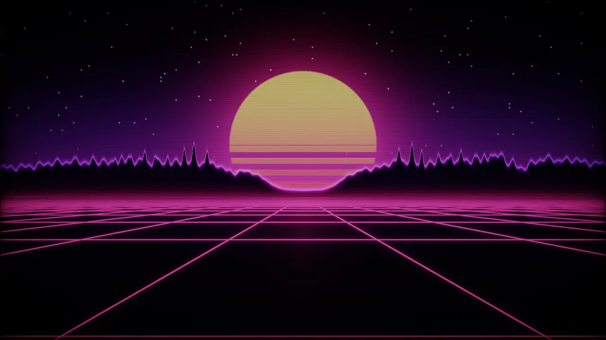

[](LICENSE)
[](#compatibility)
[](https://github.com/heynol/Android-TV-Visualizer/releases/latest)

## What it is

Remember leaving Winamp's MilkDrop running at a party? Afterglow brings that to the biggest screen in the house.
When YouTube plays music on your TV, a live visualization slides into a corner. One press of OK turns it into a
full-screen light show that reacts to the actual audio. It tells music from podcasts and talk, so it stays out of
the way for everything else. It is a sideloaded hobby project, not a Play Store app: setup needs a few `adb`
commands, and it only works with apps whose audio Android lets it hear.

## Features

- **24 hand-written GLSL ES 3.0 visuals** in four groups: spectrum and scopes, MilkDrop-style feedback flows, 3D
  worlds and generative art
- **Real audio analysis** of what is playing: 512-bin log spectrum, beats, bass transients, waveform, song energy
- **Music detection**: rhythm, harmony and speech cues plus the media session's title, so talk videos don't trigger it
- **Corner preview → full screen → carousel**, all with the TV remote, without hijacking the remote from YouTube
- **11 palettes**, per-visual speed, reactivity and up to four own knobs; remove any visual from the rotation
- **Built for slow TV GPUs**: adaptive render resolution per visual, steady 60 or 30 fps, picture delay for A/V sync
- **Reduce flashing** on by default
- **No network access.** The app has no `INTERNET` permission.
- **Shader Lab**: develop and tune the shaders in a desktop browser against a synthetic track

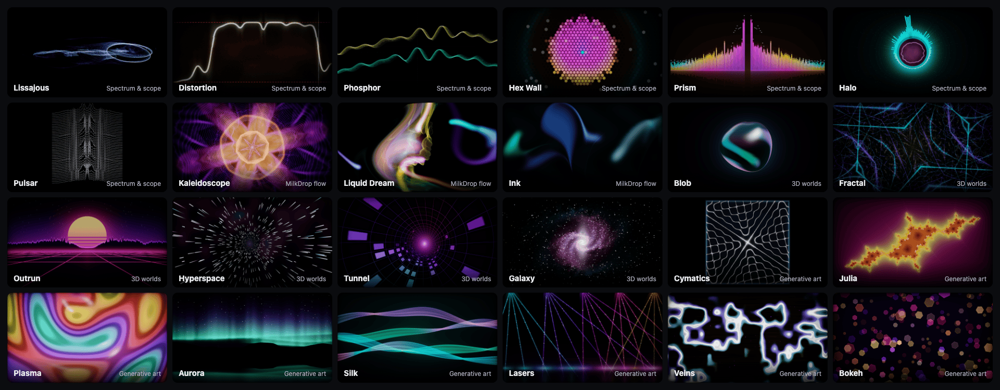

| Spectrum & scope | MilkDrop flow |
|---|---|
| 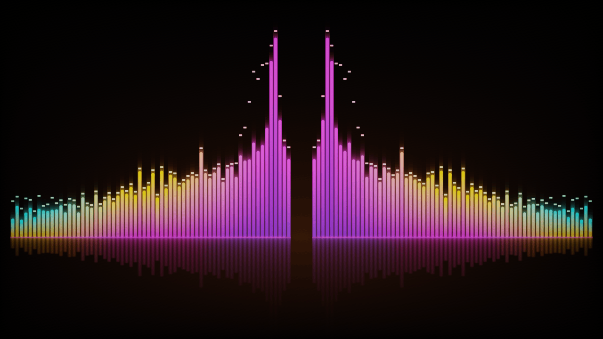 | 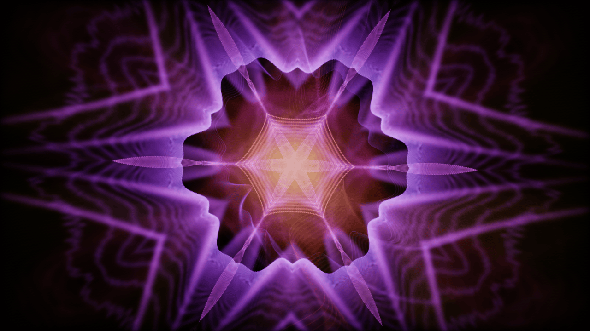 |
| **3D worlds** | **Generative art** |
| 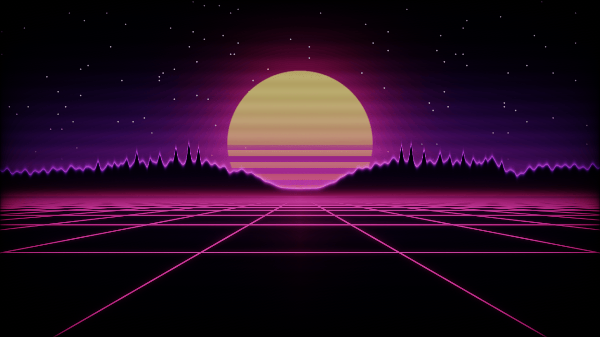 | 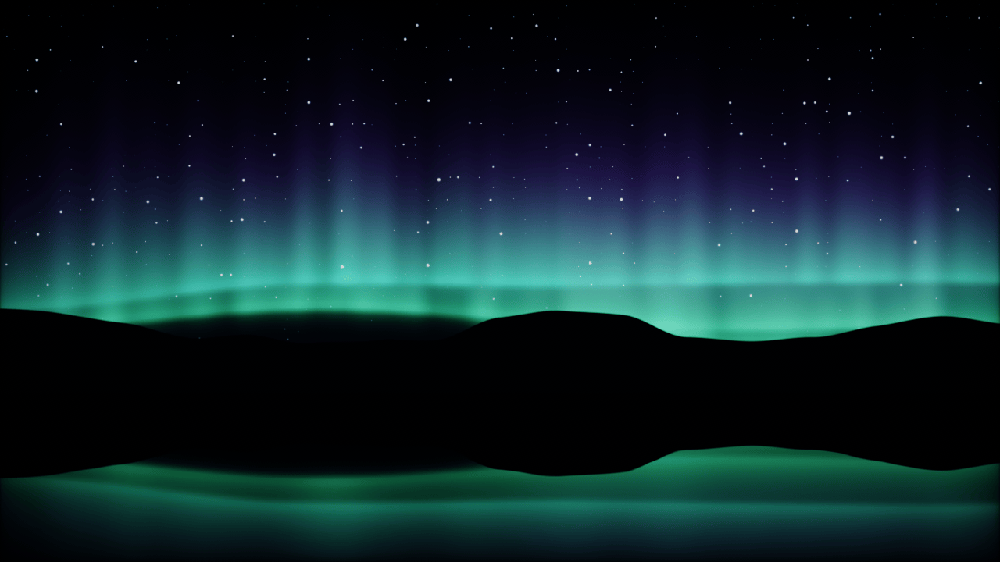 |

Recorded on the TV (screen capture of the overlay in full screen and the carousel):

| Full screen, ◀/▶ to switch | Carousel (▼) |
|---|---|
| 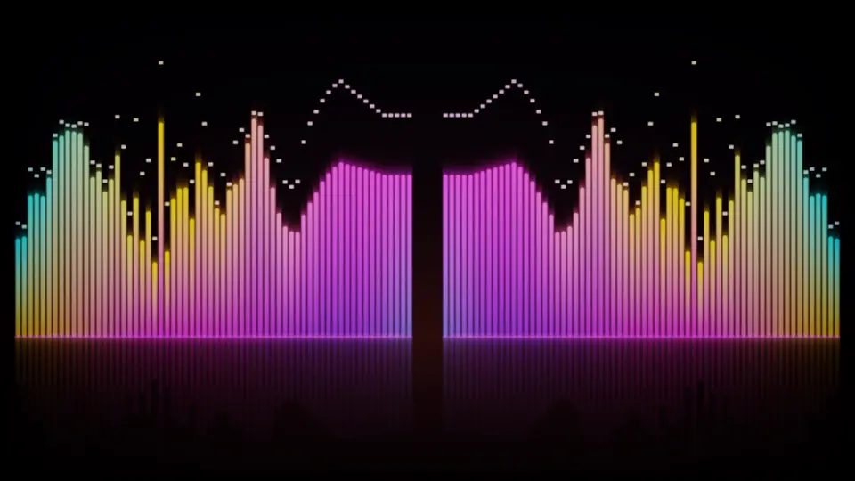 | 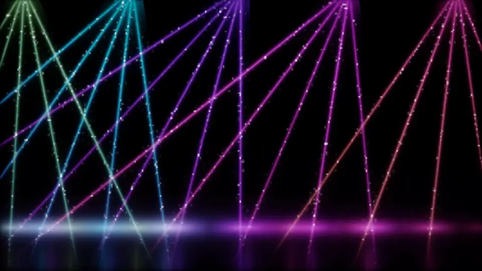 |

## Compatibility

- **Android TV / Google TV with Android 11 (API 30) or newer** and OpenGL ES 3.0. Remote focus hand-back on ▲/▼
  needs Android 13+.
- **Tested on** a Xiaomi TV (`MiTV-MOEU0`, Google TV, Android 14 / API 34, firmware `V816.0.26.3.19.002.ULBMIXM`,
  Mali-G52 GPU) with an eARC soundbar.
- **No network access**, no accounts, no analytics.
- **Performance differs a lot between TV GPUs.** Afterglow lowers each visual's internal resolution until it holds
  the frame rate, so on a slow GPU heavy visuals look softer instead of stuttering.
- Works with YouTube and YouTube Music out of the box; other apps can be enabled in the settings. Apps can opt out
  of audio capture; then there is nothing to visualize.

## Install

### Download (recommended)

Get `afterglow-<version>.apk` from [Releases](https://github.com/heynol/Android-TV-Visualizer/releases/latest).

The release APK is signed with this certificate. Check the fingerprint before installing:

```
SHA-256: A0:BD:A1:33:7D:24:4E:53:D8:11:6A:2D:A6:A0:BA:26:AD:2B:90:57:C5:87:6E:07:AD:EB:BD:E1:00:94:B3:81
```

```bash
apksigner verify --print-certs afterglow-1.0.0.apk
```

(`apksigner` comes with the Android SDK build-tools. Each release also lists the SHA-256 of the APK file itself.)

**With adb over Wi-Fi** (needed for the full setup anyway):

1. On the TV: *Settings → System → About* → click *Android TV OS build* seven times to unlock developer options.
2. *Settings → System → Developer options* → turn on *Wireless debugging* → open it → *Pair device with pairing code*.
   The TV shows an IP address, a pairing port and a six-digit code.
3. On your computer (install [platform-tools](https://developer.android.com/tools/releases/platform-tools)):

   ```bash
   adb pair <tv-ip>:<pairing-port> <code>
   ```

   ```bash
   adb connect <tv-ip>:<connect-port>
   ```

   The connect port is the one shown on the *Wireless debugging* screen itself, not the pairing port.
4. Install. `-g` grants the audio permission right away:

   ```bash
   adb install -r -g afterglow-1.0.0.apk
   ```

Then continue with [Setup](#setup).

**Without a computer** (USB stick, or an app such as *Downloader*): open the APK on the TV and allow the installing
app to install unknown apps. Then:

1. *Settings → Apps → Afterglow → ⋮ / App info* → *Allow restricted settings* (Android 13+ blocks accessibility for
   sideloaded apps until you do this; not every TV shows the option).
2. *Settings → System → Accessibility → Afterglow music visualizer* → on.
3. Open *Afterglow* from the apps row and follow the setup section on screen (audio access, overlay test).

Without adb, Afterglow falls back to an accessibility overlay, which covers the TV's volume indicator. Song info
and the remote shortcut need adb on most TVs.

### Build from source

Requirements: JDK 17 (Android Gradle Plugin 8.13), Android SDK with platform 36. Then:

```bash
./gradlew assembleRelease
```

The APK lands in `app/build/outputs/apk/release/app-release.apk`. Without the maintainer's keystore the build signs
it with your local debug key automatically (the build log says so). Such an APK installs fine, but it can't update
an official release or the other way round: uninstall first when switching.

## Setup

Each step below is one `adb` command. The app's own setup section shows the state of each step live.

| Setup status on the TV | Settings |
|---|---|
| 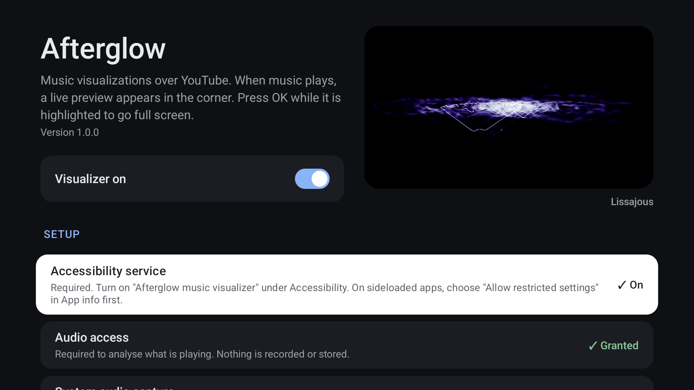 | 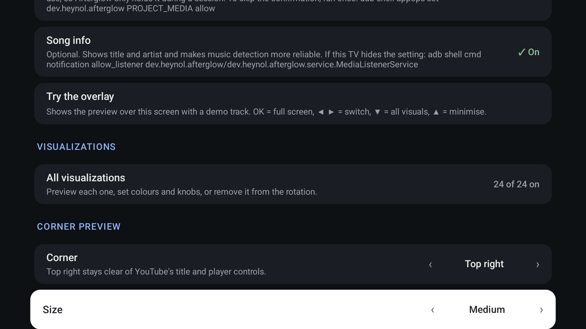 |

### 1. Accessibility service (required)

**Why:** Afterglow needs to know which app is in front (YouTube or not) and when you use the remote. It reads
window-state events (package names only) and focus/click/scroll events. It never reads screen content and never
filters or intercepts keys.

> [!WARNING]
> `settings put secure enabled_accessibility_services` **replaces** the whole list. If another accessibility
> service is enabled (TalkBack, a volume HUD, …), a plain `put` turns it off. Use this block instead. It appends
> Afterglow to the existing list and works in bash and zsh:

```bash
SVC=dev.heynol.afterglow/.service.VisualizerService
CUR=$(adb shell settings get secure enabled_accessibility_services | tr -d '\r')
case "$CUR" in null|"") NEW=$SVC ;; *dev.heynol.afterglow/*) NEW=$CUR ;; *) NEW="$CUR:$SVC" ;; esac
adb shell settings put secure enabled_accessibility_services "$NEW"
adb shell settings put secure accessibility_enabled 1
```

Check with `adb shell settings get secure enabled_accessibility_services`. All previous entries must still be there.

### 2. Audio access (required)

**Why:** to analyse what is playing. Nothing is recorded or stored. `adb install -g` already granted it; otherwise
the setup screen asks.

### 3. Overlay permission (recommended)

**Why:** an app overlay sits *below* the TV's volume panel and other accessibility overlays, so volume indicators stay
on top. Without it, Afterglow draws as an accessibility overlay and covers them.

```bash
adb shell appops set dev.heynol.afterglow SYSTEM_ALERT_WINDOW allow
```

### 4. System audio capture (only if needed)

**Why:** by default Afterglow listens through the Visualizer effect on the output mix, which needs no screen
recording. On TVs where that stays silent (tunnelled or passthrough audio), it switches to playback capture through
MediaProjection. That normally asks for consent after every reboot. This skips the dialog:

```bash
adb shell appops set dev.heynol.afterglow PROJECT_MEDIA allow
```

While capture is active, Android shows a recording indicator. Afterglow only holds it during a music session.

### 5. Song info (optional)

**Why:** the media session's title and artist make music detection more reliable and can be shown in full screen. TVs
usually hide the notification-access screen, so:

```bash
adb shell cmd notification allow_listener dev.heynol.afterglow/dev.heynol.afterglow.service.MediaListenerService
```

### 6. Remote shortcut (optional)

**Why:** once you hand the remote back to YouTube, nothing on the remote can focus the preview again without key
filtering. The system accessibility shortcut can: **hold Back + ▼**. This *replaces* the current shortcut target
(TalkBack by default):

```bash
adb shell settings put secure accessibility_shortcut_target_service dev.heynol.afterglow/dev.heynol.afterglow.service.VisualizerService
```

```bash
adb shell settings put secure accessibility_shortcut_dialog_shown 1
```

Alternatively, if your Google TV remote has a ★ / programmable key, assign *Afterglow* to it: pressed inside YouTube
it summons the visualizer, anywhere else it opens the settings.

Finally, open *Afterglow* from the apps row and press *Try the overlay* to check that everything works.

## Usage

When YouTube plays music, the preview appears in a corner and takes the remote (a ring marks it).

| Where | Key | Action |
|---|---|---|
| Corner preview (highlighted) | OK, or ▲ in a top corner (▼ in a bottom corner) | Full screen |
| | ◀ / ▶ | Switch between preview and X; OK on X hides it until you leave YouTube |
| | ▼ (▲ in a bottom corner) | Back to YouTube, the press is passed on; hidden until the next song |
| | Back | Back to YouTube; hidden until the next song |
| Full screen | ◀ / ▶ | Previous / next visual (cross-fade) |
| | ▼ | Carousel of all visuals: ◀/▶ browse, OK select, ▲ close |
| | ▲ | Minimise to the corner, preview keeps the remote (▲ again: full screen) |
| | Back | Close and give the remote back to YouTube; back with the next song |
| | OK | Show song, visual name and hints |
| Anywhere in a session | Hold Back + ▼ (accessibility shortcut), or the ★ key | Focus the preview / open it / minimise; also undoes X |

The preview highlights itself when it appears and again on each new song. Dismissed with X, it stays away until you
go Home or to another app and open YouTube again, or until the shortcut calls it back. The preview timer (30 s by
default) lets the ring run down and then hides the preview until the next song; set it to *Off* to keep the preview
focused until you close it.

### Visuals

Defined in [`visuals.json`](app/src/main/assets/visuals.json) (names, descriptions, palettes, knobs, strokes) with
shaders in [`assets/shaders/visuals`](app/src/main/assets/shaders/visuals).

| Category | Visuals |
|---|---|
| Spectrum & scope | **Prism** glossy bars, falling peaks, reflection · **Halo** radial spectrum around a nebula core · **Phosphor** dual-trace CRT scope with afterglow · **Distortion** fuzzed waveform on dirty film, beat glitches · **Lissajous** phase-figure scope · **Pulsar** "Unknown Pleasures" from spectrum history · **Hex Wall** LED stage wall with beat shockwaves |
| MilkDrop flow | **Liquid Dream** zoom/rotate/warp feedback with waveform ring · **Kaleidoscope** feedback folded into mirror crystals · **Ink** dye advected by a curl flow |
| 3D worlds | **Tunnel** neon LED tunnel · **Outrun** synthwave sun, EQ mountains, grid · **Hyperspace** lightspeed star streaks · **Blob** raymarched liquid chrome · **Fractal** endless dive into a folded neon web · **Galaxy** spiral arms lighting up band by band |
| Generative art | **Julia** morphing Julia set · **Aurora** northern lights over a lake · **Plasma** demoscene classic · **Cymatics** Chladni sand patterns from the melody's pitch · **Silk** twisting ribbons of light · **Lasers** concert beams through haze · **Veins** glowing cracks that snap to a new shape on every beat · **Bokeh** city lights per band |

Every visual has a palette (11 to choose from), speed, reactivity and up to four own knobs. Each can be removed from
the rotation in the app.

### Settings

- **Corner preview:** corner (default top right, clear of YouTube's title and controls) · size · preview timer (30 s by
  default, or off) · highlight again on a new song · hide passive preview after
- **Full screen:** auto-switch (off / every song / 1, 3, 5 min) with shuffle · song title · opacity (let the video
  shine through)
- **Music detection & audio:** when to show (when music plays / on any playback) · audio source · picture delay for A/V sync ·
  sensitivity
- **Performance:** quality cap (540p / 720p / 1080p) · frame rate (automatic, 30, 60) · reduce flashing (on by default)
- **Apps:** YouTube, YouTube Music and any other installed TV app

## Privacy

Afterglow has **no `INTERNET` permission**, so nothing it sees can leave the device. It has no analytics, no
accounts and no crash reporting.

What it reads, and only in memory:

- **Audio levels and spectrum** of what is playing, analysed in ~10 ms frames and discarded. No audio is recorded or
  stored.
- **The app in front** (package names from accessibility window events), to know whether YouTube is open.
- **Media session metadata** (title, artist, playing state), only if you grant song info. It is used for music
  detection and the optional title display.

Settings are stored locally in the app's private storage. `allowBackup` is off.

## How it works

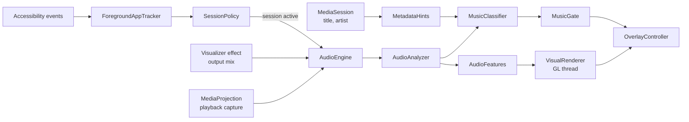

1. **Session.** [`VisualizerService`](app/src/main/java/dev/heynol/afterglow/service/VisualizerService.kt) is an
   accessibility service. It watches window-state events for package names and focus/scroll/click events to know
   the remote is in use. It never filters keys: key filtering makes some TVs' volume handling misfire.
2. **Audio.** [`AudioEngine`](app/src/main/java/dev/heynol/afterglow/audio/AudioEngine.kt) prefers the `Visualizer`
   effect on the output mix, which needs no MediaProjection and shows no recording icon. If that stays silent while
   the system reports playback, it switches to playback capture through
   [`CaptureService`](app/src/main/java/dev/heynol/afterglow/service/CaptureService.kt), only for the session.
3. **Analysis.** [`AudioAnalyzer`](app/src/main/java/dev/heynol/afterglow/audio/AudioAnalyzer.kt) builds, every
   ~10 ms, a 512-bin log spectrum (30 Hz–16 kHz, AGC, pink tilt), band levels, bass transients, beats (low-weighted
   spectral flux, adaptive threshold), song energy and a zero-crossing-triggered waveform. Frames are timestamped so
   the picture can be delayed to match TV/soundbar latency.
4. **Music or not.** [`MusicClassifier`](app/src/main/java/dev/heynol/afterglow/audio/MusicClassifier.kt) scores
   rhythm (onset autocorrelation), syllabic 3–7 Hz modulation, speech pauses, chroma stability and bass.
   [`MetadataHints`](app/src/main/java/dev/heynol/afterglow/audio/MetadataHints.kt) adds a prior from the title
   ("Artist - Topic", VEVO, "(Official Video)", podcast words, …).
   [`MusicGate`](app/src/main/java/dev/heynol/afterglow/service/MusicGate.kt) adds hysteresis: about 2.5 s of
   confidence to appear, 10–15 s of doubt or pause to leave.
5. **Rendering.** [`VisualRenderer`](app/src/main/java/dev/heynol/afterglow/render/VisualRenderer.kt) runs each
   visual on its own EGL thread into a SurfaceView. Per frame it uploads a 512×5 audio texture and a spectrum-history
   ring, runs the visual's fragment shader (optionally with feedback and a composite pass), adds thick waveform
   strokes built from `gl_VertexID`, and presents with cross-fade, tone mapping and dithering.
   [`ResolutionGovernor`](app/src/main/java/dev/heynol/afterglow/render/ResolutionGovernor.kt) remembers the frame
   rate at each resolution level and only lowers it while that buys frames. In full screen the surface turns opaque,
   so the compositor can skip the video underneath.
6. **Overlay.** [`OverlayController`](app/src/main/java/dev/heynol/afterglow/overlay/OverlayController.kt) owns one
   full-screen app overlay. The corner preview is the same SurfaceView scaled into the corner, so expanding is a pure
   view animation. The window is focusable only while the preview offers focus and in full screen. Handing the remote
   back on ▲/▼ re-sends the press with `GLOBAL_ACTION_DPAD_*` (Android 13+). Key handling is a pure state machine:
   [`OverlayStateMachine`](app/src/main/java/dev/heynol/afterglow/overlay/OverlayStateMachine.kt).

## Shader Lab

[`tools/shader-lab`](tools/shader-lab/index.html) renders the same shaders with WebGL2 (GLSL ES 3.00, same prelude,
stroke pass, feedback and composite) against a synthetic 124 BPM track. It has a grid view, palette and knob
controls, and shows compile errors with line context. From the repo root:

```bash
python3 -m http.server 8765
```

Then open http://localhost:8765/tools/shader-lab/. Edit a shader, reload, and the lab picks it up (no build step).
The shared uniforms and helpers are documented at the top of
[`common.glsl`](app/src/main/assets/shaders/common.glsl).

The Shader Lab is also set up for GitHub Pages
([`.github/workflows/shader-lab-pages.yml`](.github/workflows/shader-lab-pages.yml)) and will be available at
https://heynol.github.io/Android-TV-Visualizer/ once Pages is enabled.

For scripted captures, the page exposes `window.lab` (`seek`, `setVisual`, `size`, `paused`, `audio`, `capture`).

## Troubleshooting

**The preview never appears / Diagnostics shows audio level 0.**
Check *Diagnostics* at the bottom of the app. If *audio* stays at 0 while music plays, the Visualizer effect hears
nothing on this TV: set *Audio source* to *System audio* and grant `PROJECT_MEDIA` (setup step 4). If the
classifier score stays low for real music, set *When to show* to *On any playback*. Also check that the app is in the
enabled apps list.

**The visualizer covers the TV's volume indicator.**
Grant the overlay permission (setup step 3). Without it Afterglow falls back to an accessibility overlay, which sits
above the volume panel.

**The remote doesn't reach the preview (OK / ◀ / ▶ go to YouTube).**
The preview only takes the remote while it is highlighted (ring visible). Use the remote shortcut (hold Back + ▼, setup
step 6) or the ★ key to focus it again. Some vendor builds handle overlay focus differently. `adb logcat -s
OverlayController` with `log.tag.OverlayController DEBUG` shows `window focus` lines.

**It stutters.**
Lower *Quality* to 720p or 540p, or set *Frame rate* to 30. Heavy visuals (Blob, Fractal, Lasers, Galaxy) cost the
most; remove them from the rotation on slow TVs. `log.tag.VisualRenderer DEBUG` logs the frame rate and resolution
every 5 s.

**The accessibility service turned itself off.**
Android disables an app's accessibility service when the app is force-stopped (*Settings → Apps → Force stop*,
`adb shell am force-stop`) or uninstalled. Switching between a self-built and an official APK needs an uninstall
(different signatures). Run setup step 1 again.

## Uninstall

```bash
adb uninstall dev.heynol.afterglow
```

Android removes an uninstalled package's service from the enabled accessibility list. Check that nothing of Afterglow
is left, and that other services are still there:

```bash
adb shell settings get secure enabled_accessibility_services
```

If an entry starting with `dev.heynol.afterglow/` is still listed, remove only that entry:

```bash
CUR=$(adb shell settings get secure enabled_accessibility_services | tr -d '\r')
NEW=$(printf '%s' "$CUR" | tr ':' '\n' | grep -v '^dev.heynol.afterglow/' | paste -sd: -)
adb shell settings put secure enabled_accessibility_services "${NEW:-null}"
```

If you set the remote shortcut (setup step 6), point it back to TalkBack or clear it:

```bash
adb shell settings delete secure accessibility_shortcut_target_service
```

## Development

Requirements: JDK 17, Android SDK 36. Project layout:

```
app/src/main/java/dev/heynol/afterglow/
  audio/      capture, FFT, analysis, music classifier, metadata hints
  overlay/    overlay window, layout, key state machine
  render/     EGL thread, pipeline, resolution governor, thumbnails
  service/    accessibility service, capture service, session policy, music gate, debug receiver
  settings/   preferences
  ui/         settings screen, visuals screen, launcher entry
  visuals/    catalog (visuals.json)
app/src/main/assets/
  visuals.json            catalog: names, palettes, knobs, strokes
  shaders/common.glsl     shared prelude: uniforms and helpers
  shaders/visuals/*.frag  one fragment shader per visual (+ composite stages)
tools/shader-lab/         WebGL2 lab for the same shaders
```

**Unit tests** (analyzer, classifier, beat detection, metadata hints, session rules, key state machine, catalog):

```bash
./gradlew testDebugUnitTest
```

**Overlay without YouTube:** *Try the overlay* in the app, or this command. It shows the preview with the built-in
demo track over whatever is on screen:

```bash
adb shell am start -n dev.heynol.afterglow/.ui.MainActivity --ez test_overlay true
```

**Settings without opening the app** (which would interrupt playback), e.g. a 30 fps cap or a pinned render scale.
Extras: `fps`, `scale` (0 = automatic), `quality`, `audio_source`, `visual`. The receiver requires the `DUMP`
permission, which only the shell and the system hold:

```bash
adb shell am broadcast -a dev.heynol.afterglow.DEBUG -n dev.heynol.afterglow/.service.DebugReceiver --ei fps 30
```

**Diagnostics** at the bottom of the app update live: foreground app and session, audio source and level, classifier
score and its five cues, music probability, media session, overlay state.

**Logging:**

```bash
adb shell setprop log.tag.OverlayController DEBUG
```

`log.tag.VisualRenderer DEBUG` logs frame rate, resolution and the governor's per-level measurements every 5 s;
`log.tag.AudioEngine DEBUG` logs the audio source and levels.

```bash
adb logcat -s AudioEngine VisualizerService OverlayController VisualRenderer ShaderLibrary PlaybackCapture VisualizerSource
```

**Release signing:** `assembleRelease` reads `storeFile`, `storePassword`, `keyAlias` and `keyPassword` from the
properties file named in `$HEYNOL_SIGNING_PROPERTIES`, or `~/Keystores/heynol-sideload.properties`. Without it, the
debug key is used.

## Known limitations

- **Audio:** the Visualizer effect stays silent on tunnelled/passthrough outputs; then playback capture takes over.
  Apps can opt out of capture (YouTube's TV app allows it). Diagnostics shows which source is live.
- **Consent screen:** some TVs ship without the MediaProjection consent activity. The setup row then reads "Not
  available on this TV" and only the Visualizer effect is used.
- **Focus:** a focusable overlay taking the remote from YouTube is standard Android behaviour, but vendor builds may
  differ.
- **Detection** thresholds are tuned on synthetic signals (unit tests) and real YouTube content on one TV; the
  diagnostics card shows every cue for tuning.
- **Performance:** TV GPUs are slow and compose every layer at panel resolution; heavy visuals render at a reduced
  internal resolution. With the frame rate on *Automatic*, a visual that cannot hold 60 fps drops to a steady 30 fps
  with about twice the pixels.
- **Foreground app:** apps like YouTube draw their own UI and send no focus events. If the service starts while one
  is already open, it assumes the app whose media session is playing.
- **DRM:** some apps mark their video as secure. Afterglow still draws on top, but screen recordings of it show black.

## Contributing

Issues are welcome, especially reports from other TV models (please include the *Diagnostics* section; see the bug
report template). Pull requests for new visuals are very welcome: add the shader and its `visuals.json` entry, check
it in the Shader Lab, and attach a Shader Lab screenshot or short clip to the PR. Keep shaders cheap: they run on TV
GPUs. Shader code must be your own or under an MIT-compatible license. Shadertoy's default license (CC BY-NC-SA) is
not compatible.

## License

[MIT](LICENSE) © 2026 Pascal Heynol. Third-party credits: [THIRD_PARTY_NOTICES.md](THIRD_PARTY_NOTICES.md).

Not affiliated with or endorsed by Google, YouTube or Winamp/MilkDrop. All trademarks belong to their owners.
YouTube is named only to describe what the app works with.
